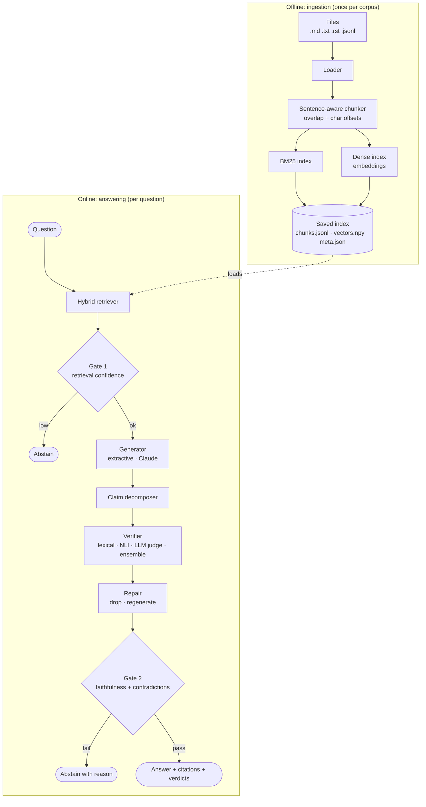
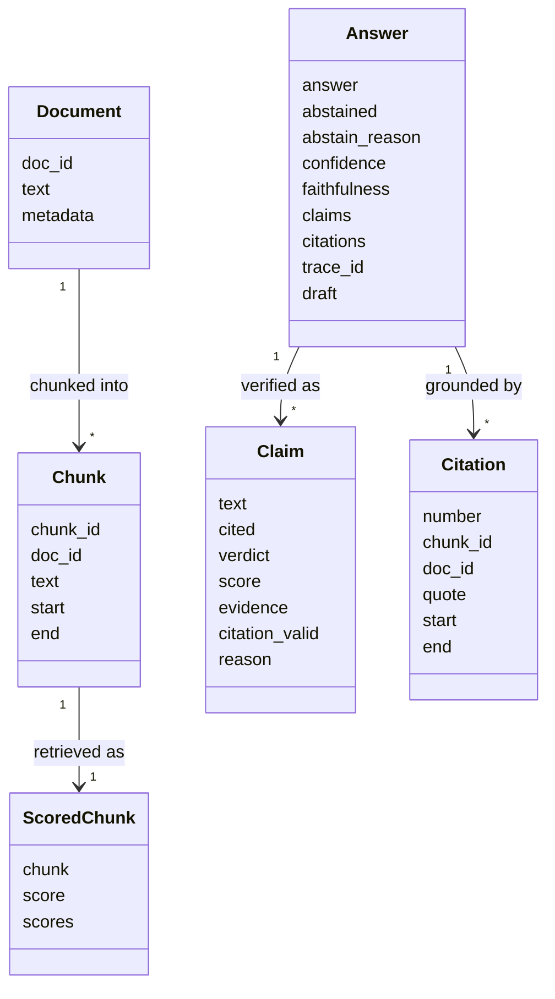
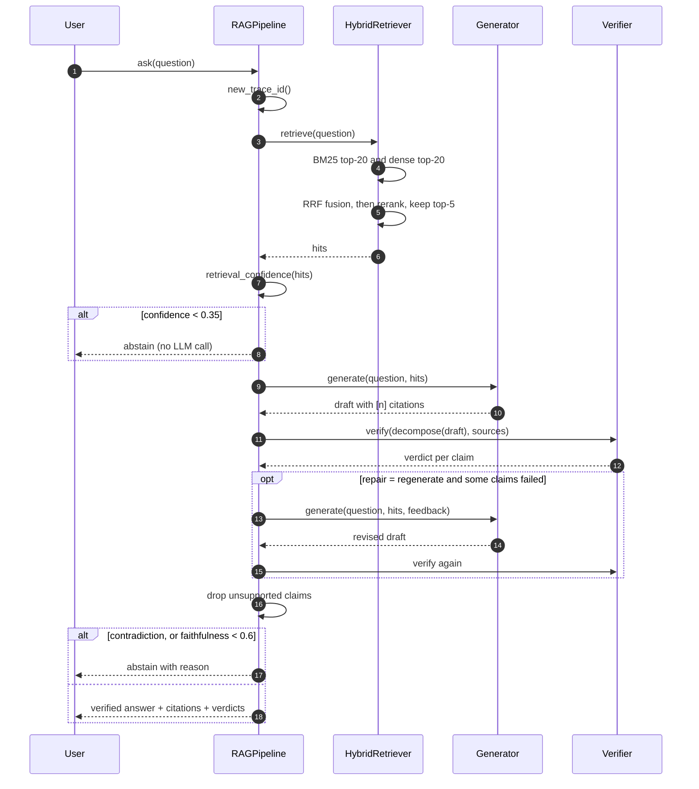
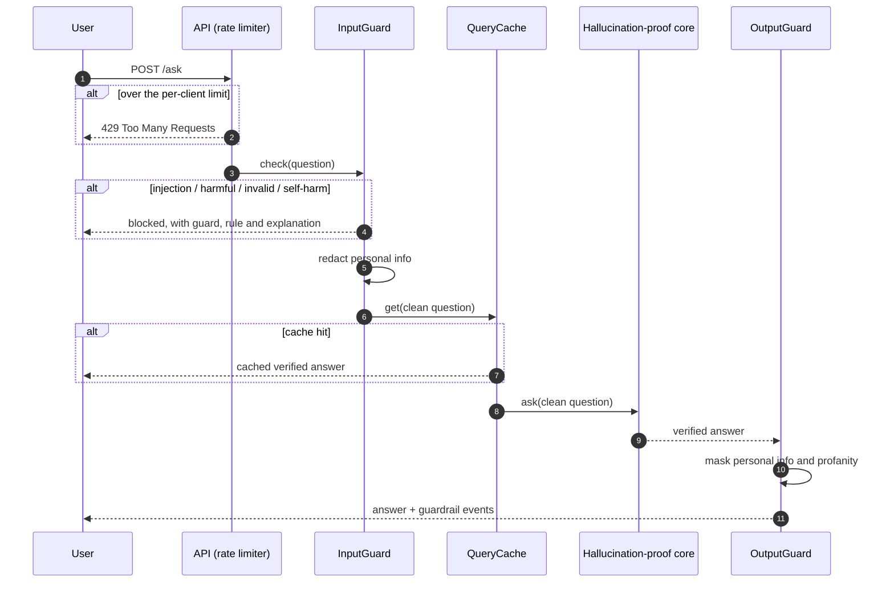

# Architecture

This document explains how the system is put together: the components, how data flows between them, and where each hallucination defence sits. For *why* each choice was made, see [DESIGN_DECISIONS.md](DESIGN_DECISIONS.md).

## 1. The big picture



## 2. Components

| Module | Responsibility | Key classes and functions |
|---|---|---|
| `ingest/loader.py` | Read files into `Document`s | `load_directory`, `load_file` |
| `ingest/chunker.py` | Split documents into sentence-aligned `Chunk`s with offsets | `SentenceChunker` |
| `retrieval/bm25.py` | Lexical search | `BM25Index` |
| `retrieval/embeddings.py` | Text to vectors | `HashingEmbedder`, `SentenceTransformerEmbedder` |
| `retrieval/dense.py` | Exact cosine search | `DenseIndex` |
| `retrieval/reranker.py` | Precision reranking of candidates | `LexicalReranker`, `CrossEncoderReranker` |
| `retrieval/hybrid.py` | Fusion, reranking, persistence | `HybridRetriever`, `rrf` |
| `confidence.py` | **Gate 1** | `retrieval_confidence` |
| `generation/prompts.py` | Grounded system prompt | `GROUNDED_SYSTEM`, `build_user_prompt` |
| `generation/providers.py` | Pluggable generators | `ExtractiveGenerator`, `AnthropicGenerator`, `ScriptedGenerator` |
| `verification/claims.py` | Answer to atomic claims and hedges | `decompose` |
| `verification/verifiers.py` | Claim checking and citation validation | `LexicalVerifier`, `NLIVerifier`, `LLMJudgeVerifier`, `EnsembleVerifier` |
| `pipeline.py` | Orchestration, repair, **Gate 2**, guardrail wiring | `RAGPipeline.ask` |
| `guardrails/` | Input, document and output guards, PII, cache, rate limiter | `InputGuard`, `DocumentGuard`, `OutputGuard`, `QueryCache`, `RateLimiter` |
| `evaluation/` | Metrics, harness, baseline | `evaluate`, `naive_pipeline` |
| `logging_utils.py` | Structured logs and trace ids | `configure_logging`, `stage` |
| `config.py` | Typed settings | `Settings` |
| `cli.py`, `api/server.py` | Interfaces: CLI and REST API | `hprag`, `create_app` |
| `api/static/index.html` | Web UI served at `/` (single file, no build step) | `hprag ui` |

Every pluggable part is defined by a small `Protocol` (`Embedder`, `Reranker`, `Generator`, `Verifier`), so implementations can be swapped through configuration without touching the pipeline.

## 3. Data model



`ScoredChunk.scores` holds every score a chunk collected (`bm25`, `dense`, `rrf`, `rerank`), which the logs print for each hit.

`Answer.draft` keeps the unverified text from the generator, so you can always compare what the model wrote with what the user was shown.

## 4. Answering a question, step by step



## 5. The defence layers

Each layer catches a different failure. None of them is enough alone.

| # | Layer | Catches | Where |
|---|---|---|---|
| 1 | **Hybrid retrieval and reranking** | Missing evidence caused by poor search | `retrieval/` |
| 2 | **Gate 1: retrieval confidence** | Questions the corpus can't answer, especially about unknown entities | `confidence.py` |
| 3 | **Grounded prompt** | Use of outside knowledge, uncited claims, numeric drift, unsupported inference | `generation/prompts.py` |
| 4 | **Abstain token** | Gives the model a sanctioned way to say "not in the sources" | `INSUFFICIENT_EVIDENCE` |
| 5 | **Claim verification** | Invented facts inside an otherwise good answer | `verification/` |
| 6 | **Contradiction checks** | Wrong numbers, flipped negation, opposite words | `LexicalVerifier.score_pair`, NLI, judge |
| 7 | **Citation validation** | Right claim with the wrong source | `_finalise` → `citation_valid` |
| 8 | **Repair** | Removes or rewrites the bad claims, keeps the good ones | `RAGPipeline.ask` |
| 9 | **Gate 2: faithfulness** | Drafts that were mostly wrong, and any contradiction | `RAGPipeline.ask` |

### How Gate 1 scores confidence

```
top_score  = rerank score of the best chunk                     (0..1)
coverage   = IDF-weighted share of question words found in the top-k chunks
confidence = 0.5 · top_score + 0.5 · coverage
if any question word never appears anywhere in the corpus: confidence × 0.5
```

Words that only shape a question ("how many", "how long", "percentage") are ignored, so they don't count as missing.

### How the lexical verifier judges a claim

For each source, the claim is compared with every sentence and every pair of adjacent sentences (the "premises"):

1. **Coverage**: the IDF-weighted share of the claim's content words found in the premise.
2. **Numbers**: every number in the claim must appear in the premise. If the premise is clearly about the same thing (coverage ≥ 0.6) but has *different* numbers, the claim is **contradicted**.
3. **Negation**: when the topic matches but only one side is negated, the claim is **contradicted**.
4. **Antonyms**: "increases" vs "decreases", "before" vs "after" and similar pairs mean **contradicted**.
5. Otherwise the claim is **supported** when its best score is at least `min_claim_support` (0.55), and **unsupported** when it is lower.

## 6. Guardrails

Guardrails wrap the core pipeline. Hallucination defences decide whether an *answer* is faithful; guardrails decide whether a *request* or *document* should be processed, and what must be hidden from the output.



| Guard | Runs on | Action | Module |
|---|---|---|---|
| Input validation | question | block | `guardrails/guards.py` → `InputGuard` |
| Prompt injection / jailbreak | question | block | `guardrails/rules.py` → `INJECTION_PATTERNS` |
| Harmful requests | question | block | `UNSAFE_PATTERNS` |
| Wellbeing | question | supportive reply | `SELF_HARM` |
| PII | question, answer, citations | redact | `guardrails/pii.py` |
| Hidden instructions | documents at ingest | remove the sentence, keep offsets | `DocumentGuard` |
| Profanity | answer | mask | `OutputGuard` |
| Cache | question | serve the verified answer | `QueryCache` |
| Rate limit | API request | 429 | `RateLimiter` in `api/server.py` |

Every decision becomes a `GuardEvent(guard, action, detail, explanation)`. Events are attached to `Answer.guardrails`, shown in the UI, and logged under the `guardrails` logger with the trace id.

## 7. Logging and observability

Every stage logs through `hprag.logging_utils`. Each question gets a `trace_id`, and every log line produced while answering it carries that id. Stages wrapped in `stage(...)` log a `*.start` line at DEBUG and a `*.end` line at INFO with `ms=` timing. See [LOGGING.md](LOGGING.md) for the full event list and examples.

## 8. Extending the system

| You want to… | Do this |
|---|---|
| Add an LLM provider | Implement `generate(question, hits, feedback=None) -> str` and register it in `make_generator` |
| Add a verifier | Implement `verify(claims, sources, threshold) -> claims` and register it in `make_verifier` |
| Use a vector database | Replace `DenseIndex.build` and `DenseIndex.search` |
| Support PDFs | Convert to text upstream, then ingest the `.txt` (see the loader docstring for why) |
| Tune strictness | Change `GuardConfig` thresholds and measure with `hprag eval` |
| Add a guardrail rule | Add a pattern to `guardrails/rules.py` and a positive and a negative test in `tests/test_guardrails.py` |
| Add a model-based guardrail | Add a check in `InputGuard.check` that returns `self._block(...)` with a clear detail |
